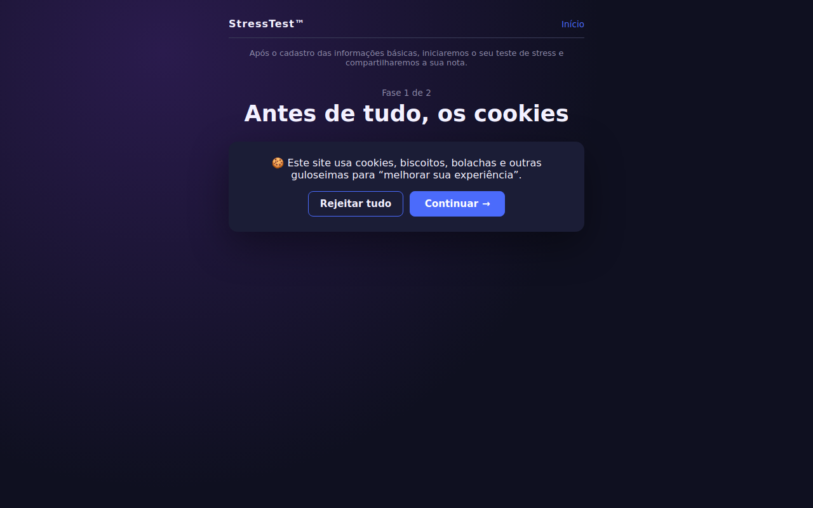
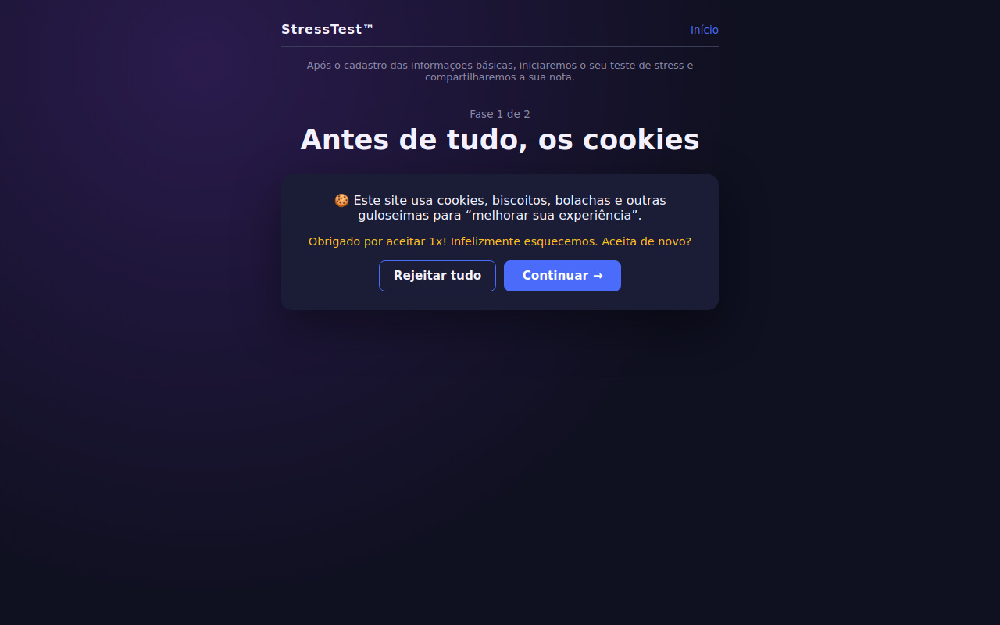
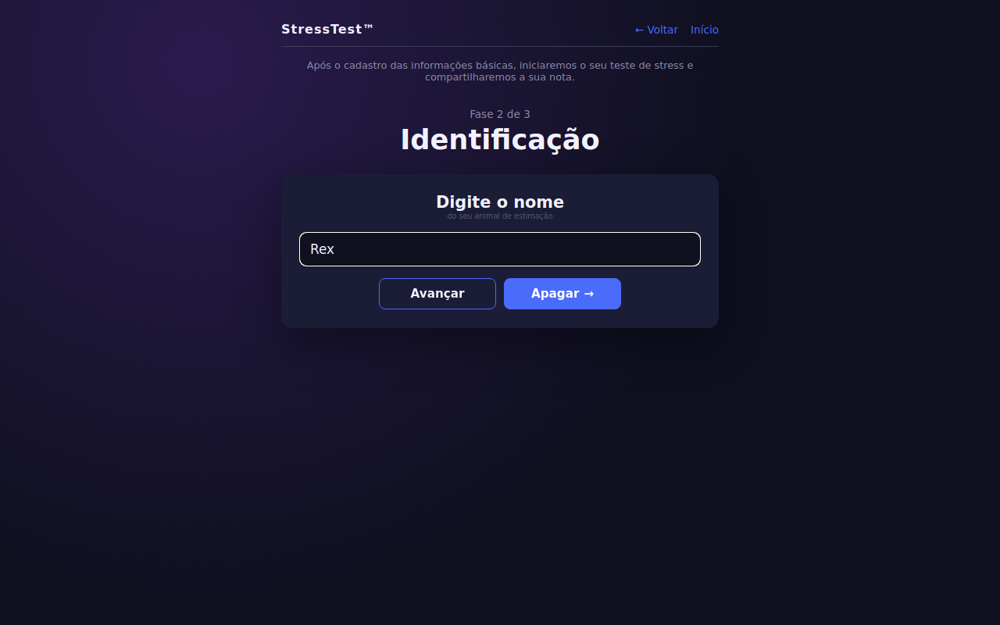
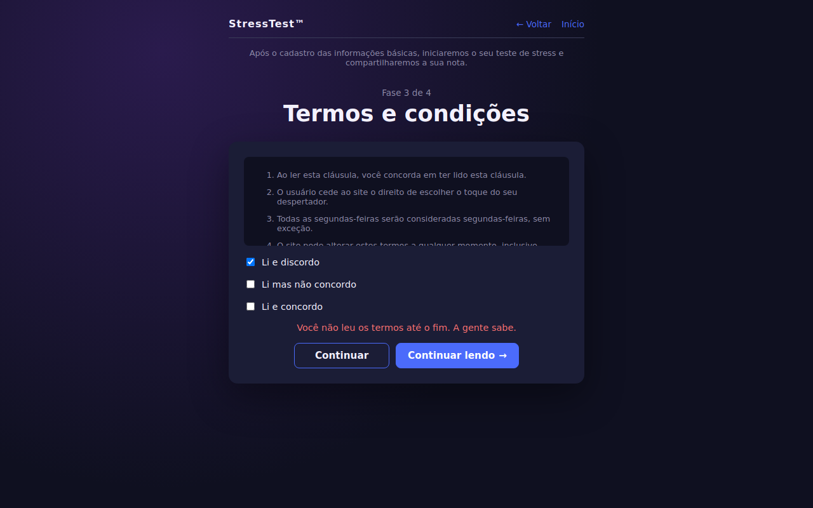
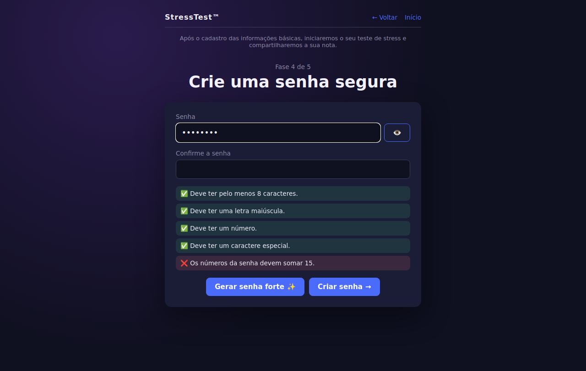
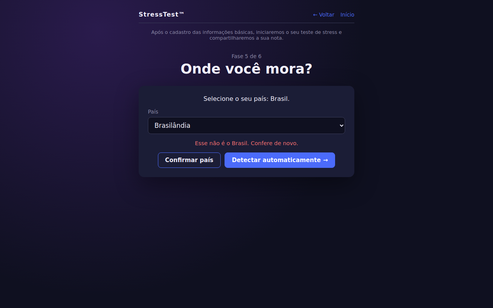
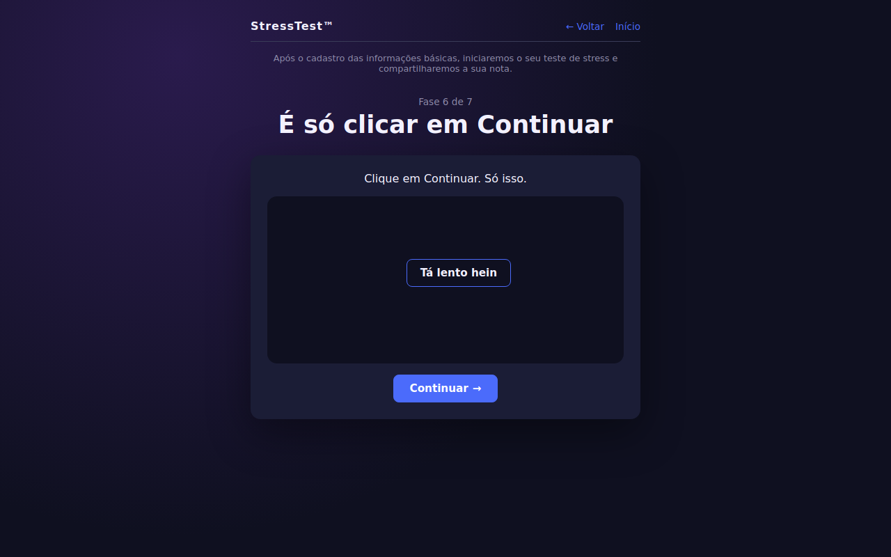
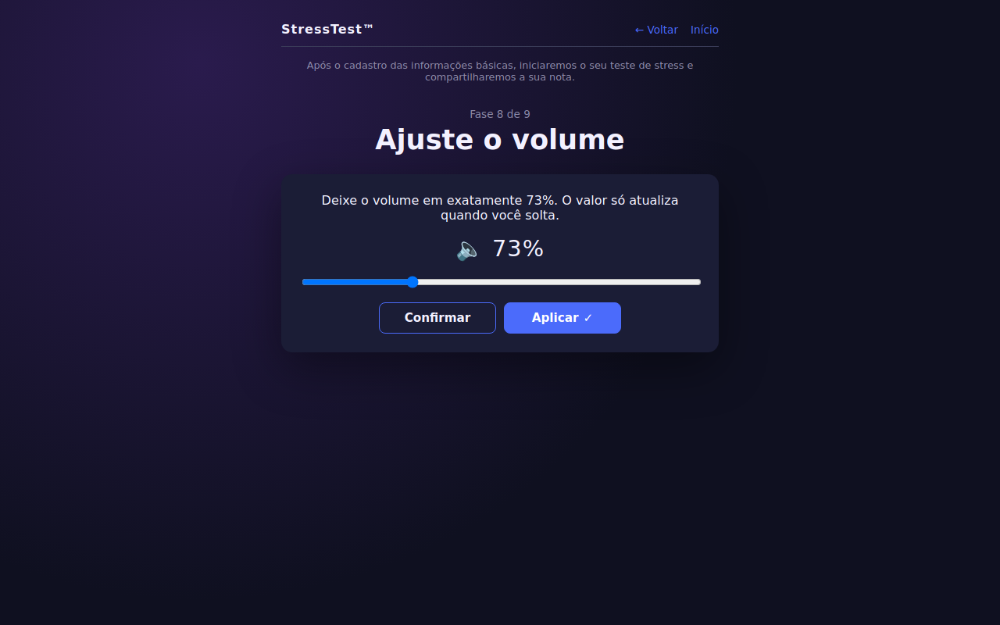
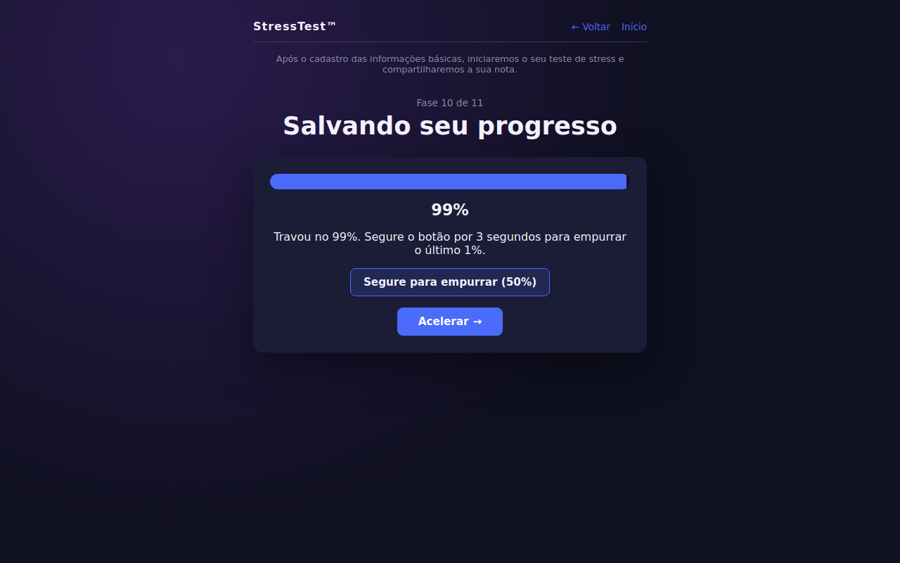

# Stress Test 😤

Um jogo curto de fases em que a interface é a inimiga. Cada fase parece uma tarefa
banal de qualquer site (aceitar cookies, digitar o nome, criar uma senha) e foi
desenhada para irritar do jeito mais educado possível.

Feito por diversão, com React, TypeScript e Vite.

## As fases

| # | Fase | O que te espera |
|---|---|---|
| 1 | Antes de tudo, os cookies | Um banner que esquece que você já aceitou |
| 2 | Digite o seu nome | Botões que trocam de lugar quando você menos espera |
| 3 | Termos e condições | Só dá para aceitar depois de rolar até o fim |
| 4 | Crie uma senha segura | Regras que aparecem uma de cada vez, cada uma pior que a anterior |
| 5 | É só clicar no botão | O botão foge do cursor |
| 6 | Informe seu celular | O número é escolhido num controle deslizante |
| 7 | Prove que você é humano | Um captcha com instruções criativas |
| 8 | Salvando seu progresso | Uma barra de progresso que trava em 99% |
| 9 | Parabéns (eu acho) | O certificado, com o seu nome escrito errado |

O contador mostra sempre só uma fase à frente, então você nunca sabe quanto falta.

## Pontuação

Cada fase concluída dá pontos. Cair nas armadilhas tira pontos: aceitar cookies sem
ler, obedecer ao botão bonito, tentar pular os termos, cancelar o salvamento e por aí
vai. O placar muda de canto a cada fase e mostra os últimos eventos.

No fim, o certificado te dá um título conforme a pontuação:

- **Vítima Oficial do Design**: pontuação negativa
- **Sobrevivente da Interface**: de 0 a 99 pontos
- **Mestre Zen da UX Hostil**: 100 pontos ou mais

## Telas

| | |
|---|---|
|  |  |
| Fase 1: o banner de cookies | Aceitou? Esquecemos. Aceita de novo? |
|  |  |
| Fase 2: o nome começa pelo do pet | A confirmação embaralha tudo |
|  |  |
| Fase 3: termos que exigem leitura até o fim | Fase 4: as regras da senha aparecem uma a uma |
|  |  |
| Fase 5: a detecção automática erra o país | Fase 6: o botão foge do cursor |
|  |  |
| Fase 7: DDD por extenso e número no slider | Fase 8: o volume só atualiza quando você solta |
|  |  |
| Fase 9: um captcha com instruções criativas | Fase 10: a barra trava em 99% |
|  |  |
| O certificado, com o nome escrito errado | No celular |

## Rodando localmente

Precisa de Node.js 20 ou superior.

```bash
npm install
npm run dev
```

Outros scripts:

| Comando | O que faz |
|---|---|
| `npm run build` | Checa os tipos e gera a versão de produção em `dist/` |
| `npm run preview` | Serve o build de produção localmente |
| `npm run lint` | Roda o ESLint |

## Estrutura

```
src/
├── game/     # fluxo das fases (Game.tsx) e a lista delas (levels.ts)
├── levels/   # um componente por fase, com a lógica pura em arquivos .ts
└── score/    # placar e reducer de pontuação
```

Para criar uma fase nova, escreva um componente que recebe `LevelProps`
(`src/game/types.ts`), chame `onComplete` quando o jogador passar e `onPenalty` quando
ele cair numa armadilha, e acrescente a fase em `src/game/levels.ts`.
